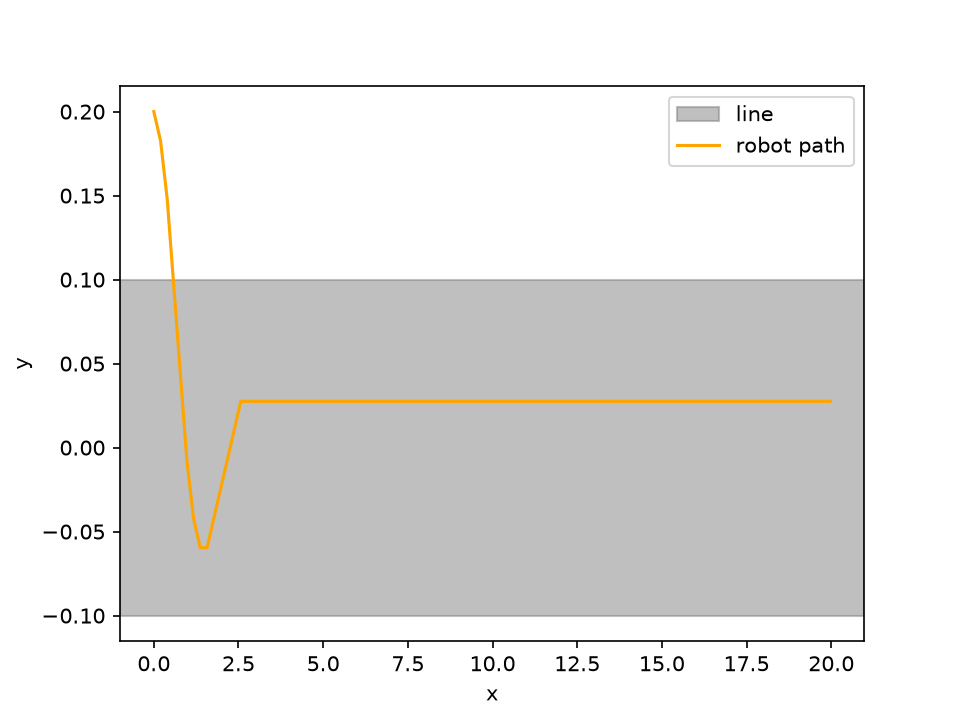

# Line-Following Robot Simulator

A small Python simulation of a robot that follows a line using two sensors.
No hardware needed. It runs on the screen and draws the path it took.



## What it does

The robot starts 0.2 above a straight line. Two sensors at the front check
if the floor under them is the line. A simple rule turns the robot toward
the line. The picture shows the robot dipping down, overshooting a little,
then settling on the line.

## How to run

```bash
git clone git@github.com:playfu1-d0ubt/line-following-robot.git
cd line-following-robot
python3 -m venv venv
source venv/bin/activate
pip install -r requirements.txt
python main.py
```

This prints the robot's path and saves a picture to `export/path.png`.

To run the tests:

```bash
python -m pytest
```

## How it works

- `robot.py`: position, heading, and moving.
- `line.py`: the strip of tape on the floor.
- `sensor.py`: where a sensor sits and if it is over the line.
- `controller.py`: the steering rule.
- `simulate.py`: runs the robot one moment at a time.
- `plot.py`: draws the path.

## Limitations

- The line is straight. No curves yet.
- Steering is a simple rule, not PID. The robot settles near the line,
  not exactly on the middle.
- The picture stretches the y axis, so the wobble looks bigger than it is.
- No wheels, friction or sensor noise. It is a learning simulation.

## What I learned

- Argument order matters. I swapped `left` and `right` in `tick`, and the robot steered away from the line. Python matches arguments by position, not by name.
- I used `cos` and `sin` for the first time in code, to move and turn the robot. Degrees must become radians first.
- One wrong sign makes the robot run away. Tests now catch that.